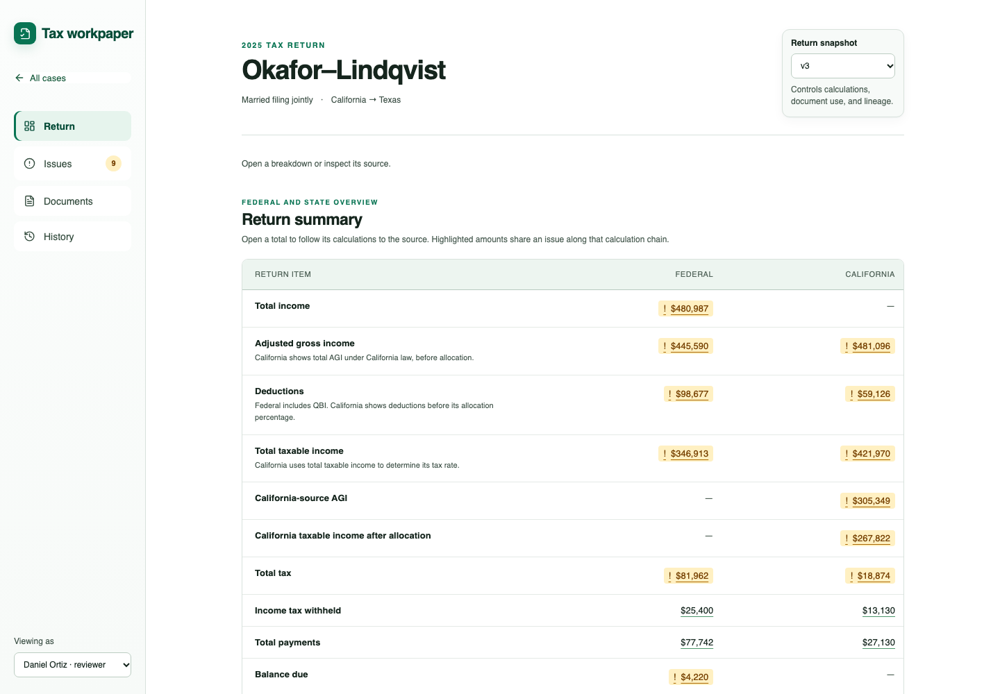

# Tax Workpaper

A React and TypeScript prototype for reviewing a complex tax return from calculated amounts back to source evidence.

**Live demo:** [haileyxue.github.io/tax-workpaper](https://haileyxue.github.io/tax-workpaper/)



## Features

- Return-first review with calculation lineage and source-field tracing
- Independently detected discrepancies, including high-confidence extraction errors
- Resizable simulated-document viewer with highlighted evidence
- Role-aware assignment, correction, and approval workflow
- Immutable return snapshots with append-only review history
- Browser-local persistence, undo, and JSON audit export

## Run locally

Requires Node.js 22.12 or later.

```sh
npm ci
npm run dev
```

Open the local URL printed by Vite.

## Validate

```sh
npm run check          # TypeScript and domain tests
npm run build          # Production build
npm run format:check   # Formatting
npx playwright install chromium
npm run test:e2e       # Browser workflows
```

## Project structure

```text
src/
  components/    UI and review workflow components
  domain/        Packet model, lineage, validation, and review rules
data/            Immutable input packet
tests/           Domain and browser tests
case-study/      Assignment brief, submission documents, and demo assets
.github/         Continuous integration and GitHub Pages deployment
```

The application imports [`data/okafor_lindqvist_2025_packet.json`](data/okafor_lindqvist_2025_packet.json) directly. Its top-level `readme` property documents the supplied schema. Source evidence and computed return versions remain unchanged; user actions are stored separately as review events in `localStorage`.

## Prototype boundaries

- Corrections show an estimated impact but do not rerun a tax engine.
- Role controls demonstrate workflow behavior; they are not server-side authorization.
- Persistence is local to one browser and does not support concurrent users.
- Filing, e-signatures, amendments, and post-filing case management are outside this prototype.
- The packet contains fictional data and simulated documents; do not load real client data.

## Case-study materials

The original brief and applicant deliverables are isolated from the technical codebase in [`case-study/`](case-study/). Start with:

- [Approach and data model](case-study/APPROACH_AND_DATA_MODEL.md)
- [Demo walkthrough](case-study/DEMO_WALKTHROUGH.md)
- [Errors found](case-study/FINDINGS.md)
- [Decision record](case-study/DECISIONS.md)
- [Original assignment](case-study/ASSIGNMENT.md)

OpenAI Codex assisted with repository analysis, implementation, documentation, and validation.
