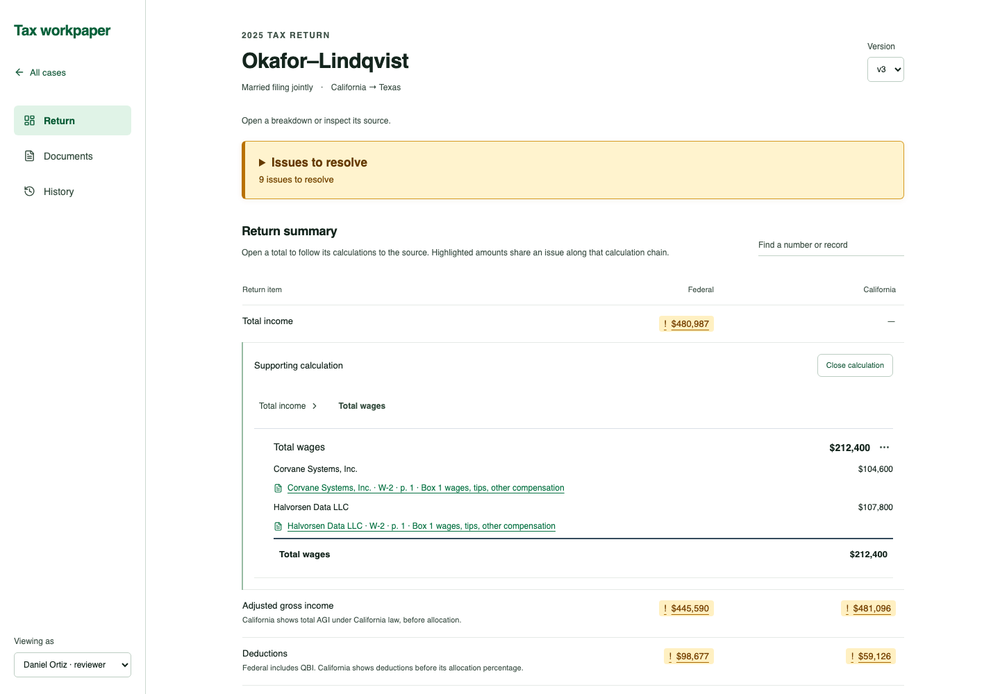

# Tax workpaper

An evidence-first review workspace for the fictional Okafor–Lindqvist household's 2025 return. Built with React and TypeScript against the **unaltered supplied packet**: 74 documents, 3,012 extracted values, and three computed return versions.

This is an actively developed case-study prototype. It is not tax preparation software and does not recompute or file a return.



The private GitHub repository is the source of truth. Development and testing happen locally; cloud hosting is deferred until the user considers the app finalized.

## Run locally

Requires Node.js 22.12+ (Node 24 recommended).

```sh
npm ci
npm run dev
```

Open the localhost URL printed by Vite. For validation:

```sh
npm run check  # TypeScript and domain tests
npm run build  # Production bundle
npx playwright install chromium
npm run test:e2e  # Browser workflow and mobile checks
npm run format:check  # Repository formatting
```

## Try the review loop

1. Open the supplied household from **Cases**, where the badge shows its latest-version **issues to resolve**. On **Return**, compare federal and California totals in the unified summary.
2. Select federal **Total income**, then the Corvane W-2 source link under wages. The evidence panel highlights `104,600.00` while the calculation stays visible. No verification action is required.
3. Open **Issues** in the left navigation and select **Same bank sweep interest counted twice**. Return opens the calculation path and smoothly scrolls to the source. Both source amounts and affected totals are highlighted.
4. Use **Decision & assignment** beside the linked calculation to record a disposition. To propose a correction, use **… → Propose correction** on the affected amount. Enter the proposed value, select a supplied tax-effect category, and add a rationale. Estimated effects appear; engine totals remain unchanged.
5. Reload, reopen the case, and visit **History** to inspect the proposal, compare snapshots, view precomputed alternatives, or undo your own action. Export history for a portable record.
6. Final review sign-off is available to a reviewer or partner only after blocking warnings, manual flags, and correction proposals are cleared. Subsequent review events reopen it. This is a local review acknowledgment, not an e-signature or filing approval.

## What works today

- One packet-backed summary integrates totals, supporting calculations, and other return records. Separate payer tabs, return search, and the duplicate calculation index have been removed. Missing mappings display a dash, never an invented zero.
- A Cases landing page with live issue counts for the supplied household and an All cases navigation link.
- One white-background Return workspace with selective calculation breakdowns; Documents and History are secondary tools in the left sidebar.
- Focused calculation statements with aligned inputs and results. Selecting an input replaces the detail in place; a review trail returns to earlier contexts. Same-form related records stay separate from arithmetic inputs.
- The Issues tab contains direct links only. Selecting an issue switches to Return, reveals its real dependency path, focuses the source, and scrolls smoothly (or instantly with reduced motion). Highlighting follows the affected chain without flagging unrelated inputs. Assignment and resolution are contextual, beside the linked calculation.
- Evidence displayed in a resizable panel beside the calculation on desktop and in a bottom panel on mobile; other document fields and reverse usage are collapsed by default.
- All 627 current-version lines remain reachable through summary calculations or Related return records; large input lists load in batches with filtering.
- No routine verification forms: contextual flag, note, and correction actions open only on request. Existing verification records remain in history.
- Engine diagnostics plus independent duplicate-interest, FX-year, and W-2 source checks; assignment and documented resolution.
- Final, version-scoped review sign-off with blocker checks and conservative invalidation after any subsequent review event (including notes, assignments, and undo).
- Browser-local persistence, append-only history, undo, and JSON export with visible save errors.
- All three engine snapshots and five precomputed alternatives remain available.

## Deliberate limits

- **Local persistence:** reviews live in this browser's `localStorage`; there is no server, cross-device sync, or concurrent-user conflict handling. Export is available; import is not yet implemented.
- **Role simulation:** client-side restrictions are UX behavior, not secure authorization. The complete fictional packet is bundled, including fictional identifiers. Do not load real client data.
- **Review, not recalculation:** corrections are proposals. Estimates use manually selected packet rates and are not cumulative recomputed return totals. Currency, California sourcing, thresholds, credits, and QBI require review.
- **Filing is not implemented:** the final review sign-off is a local acknowledgment only. Client authorization, e-signatures, filing freezes, amendments, notices, and production retention controls remain future work. Later timeline events are labeled scripted scenario data.
- **Source fidelity:** the packet has no PDFs. Synthetic coordinates are not presented as real PDF coordinates. Ambiguous or absent text gets a field/page locator and a visible warning, not a fabricated highlight.
- **Coverage:** automated checks are intentionally narrow; no claim that every planted error has been found. All 627 current-version lines remain accessible through Summary breakdowns and Related return records; dedicated asset/basis editors remain future work.

## Repository guide

| Path                                | Purpose                                                                             |
| ----------------------------------- | ----------------------------------------------------------------------------------- |
| `CASE_STUDY.md`                     | Original employer brief                                                             |
| `okafor_lindqvist_2025_packet.json` | Original, immutable fixture; schema guide is its `readme` property                  |
| `src/domain/`                       | Packet types, lineage graph, independent checks, review rules                       |
| `src/components/`                   | Calculation tree, evidence viewer, exception form, history, and issue components    |
| `src/App.tsx`                       | Workspace screens and local review orchestration                                    |
| `tests/`                            | Lineage, check, permission, undo, and estimate regression tests                     |
| `docs/`                             | Architecture, findings, requirement coverage, implementation decisions, and roadmap |
| `.github/workflows/ci.yml`          | Reproducible test/build checks                                                      |

## Submission notes

The living [decision log](docs/DECISIONS.md#dated-decision-records) records rationale, alternatives, tradeoffs, superseded choices, and proposal/implementation status.

See [core idea and data model](docs/ARCHITECTURE.md), [requirements traceability](docs/REQUIREMENTS_TRACEABILITY.md), [findings](docs/FINDINGS.md), and [decisions and next steps](docs/DECISIONS.md). The applicant's recorded walkthrough and video link are still required by the case study.

AI assistance: OpenAI Codex helped inspect the fixture, design and implement the prototype, write documentation, and run validation. Human review and the applicant's own explanation of tradeoffs remain essential.
