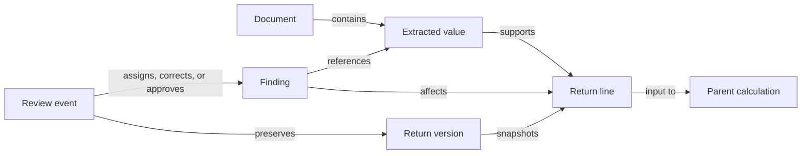

# Approach and key decisions

## Core idea

I designed the workpaper around one principle: **a number is a doorway into its evidence, not a cell to overwrite**.

A reviewer starts with the return, opens a number, follows its calculation, and sees the exact document field that supports it without leaving the surrounding context. If the number is questionable, the same view contains the evidence, proposed correction, assignment, and approval history. The Issues queue is a second entry point into this same review state rather than a separate workflow.

This led to a return-first interface instead of a spreadsheet or a collection of disconnected schedules. The main view stays recognizable to a CPA because it begins with return totals, but each total behaves like an explorable calculation. Only the active calculation is expanded, and a visible path shows where the reviewer is. This avoids both spreadsheet density and an endless tree of nested cards.

## Data model

The application preserves three different kinds of truth:

1. **Evidence** — documents and extracted values, including page, field, source text, and confidence.
2. **Engine output** — immutable `v1`, `v2`, and `v3` return snapshots containing calculated lines and their dependencies.
3. **Human judgment** — append-only review events containing the action, actor, role, timestamp, return version, rationale, and affected evidence.

At load time, the app builds ID maps and a directed lineage graph from the supplied packet. Forward edges explain how a return number was built. Reverse edges answer the equally important question: “If this source is wrong, what else is affected?” The same graph supports source tracing, affected-chain highlighting, document usage, issue navigation, and version-aware review.

The original JSON remains unchanged. A correction is stored as a proposal over a specific source value; it never silently replaces the extracted value or a supplied engine total. Approval completes the human review decision, while the proposal remains a filing blocker until a recomputed return snapshot incorporates it. This distinction prevents the interface from implying that it can run a tax engine when it cannot.

## Key decisions

### Treat extraction confidence as metadata, not verification

The most important independent check demonstrates why an AI workpaper cannot accept confidence at face value. In the supplied brokerage statement, a blank RSU cost basis was normalized to `$0` with 98% confidence. The app detects that the source was blank, confirms that the zero feeds the return, and reconciles the lot to a separate stock-plan statement using the supplied acquisition date. That statement provides a `$19,100` adjusted basis.

This is a deterministic, explainable validation rule. It surfaces the observed source, contradictory evidence, matching key, affected Form 8949 line, downstream return lines, and proposed tax effect. The system does not silently “fix” the return; it gives the CPA enough evidence to decide.

### Keep issue review in the calculation

An issue belongs at the lowest calculation level where a reviewer can understand and act on it. Selecting an issue from the queue navigates to that level. A CPA who reaches the same calculation manually sees the identical issue and controls. This creates one canonical place for the evidence and decision, while the queue remains a prioritized work list.

### Record changes as events

Assignments, correction proposals, approvals, and undo actions are stored as append-only events. This preserves the original value and reconstructs who did what, why, and against which return version. Role controls demonstrate separation of duties: a preparer can propose a correction, while a reviewer or partner must assign and approve it. For the prototype these controls and saves are browser-local; production authorization and durable audit storage would belong on a server.

### Be explicit about prototype boundaries

The app displays only facts contained in the packet. Simulated documents use supplied printed text, and estimated tax effects use supplied rates and are labeled as estimates. Missing values remain missing rather than becoming zero. Filing, e-signature, secure multi-user access, and engine recomputation are not claimed. I also omitted the packet’s future scripted events because showing them as a timeline would suggest a filing lifecycle that the prototype does not implement.

## AI use

I used OpenAI Codex to inspect the packet, test data relationships, implement and refactor the application, and maintain documentation and automated checks. I reviewed the product decisions, validation logic, scope boundaries, and final behavior. The application uses deterministic local rules at runtime; it does not call an AI model or invent taxpayer data.
