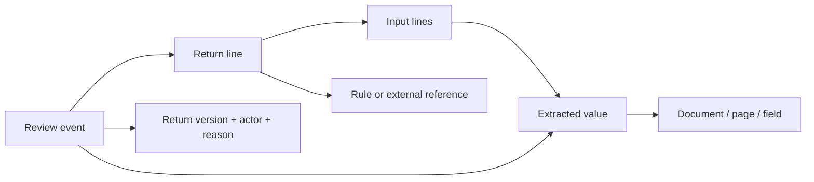

# Core idea and data model

**A number is a doorway into its evidence, not a cell to overwrite.** A CPA should be able to move from a return total to its calculation inputs, inspect the exact source page and field, record judgment, and see everywhere that judgment matters.

The workspace separates three kinds of truth:

1. **Source evidence:** the packet's document `printed_content`. Extracted values are separate assertions, with confidence and a page/field locator. Confidence is never verification.
2. **Engine snapshots:** immutable v1/v2/v3 calculation graphs. Each line has an ID, value, rule, input lines, and evidence references. The graph follows these edges recursively and indexes them in reverse for impact exploration.
3. **Human review:** version-scoped events containing actor, timestamp, action, target, reason, and optional verification method or adjustment. Corrections preserve the engine original. Undo adds a compensating event.

`createGraph` builds ID maps for each version and reverse consumer edges. Reference resolution supports extracted values, documents, prior-year and agency JSON pointers, parameters, FX rates, assets, people, timeline events, client communications, and explicit page references. Missing links remain visible. Visited sets prevent cycles from hanging traversal.

The source viewer renders the supplied page text, not a transcription of the extracted values. A unique exact text match receives a highlight; otherwise the viewer states that exact location is uncertain. The document ID, page, field key, and synthetic coordinates remain available in the model so a PDF/image viewer can replace the renderer without changing the graph.

The first implementation uses a static React/TypeScript app and localStorage to make the review loop easy to run and inspect. Domain logic is isolated from UI components. This is a prototype boundary: a production system would put role enforcement, event append operations, optimistic concurrency, encrypted evidence storage, access logging, and filing snapshots behind authenticated server APIs.

Tax effects use the packet's per-dollar category rates and are labeled estimates. The five supplied alternatives show actual precomputed scenario deltas. Neither pathway claims to run a tax engine.
