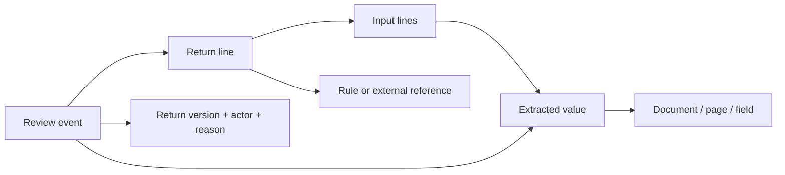

# Core idea and data model

**A number is a doorway into its evidence, not a cell to overwrite.** A CPA should be able to move from a return total to its calculation inputs, inspect the exact source page and field, record judgment, and see everywhere that judgment matters.

The workspace separates three kinds of truth:

1. **Source evidence:** the packet's document `printed_content`. Extracted values are separate assertions, with confidence and a page/field locator. Confidence is never verification.
2. **Engine snapshots:** immutable v1/v2/v3 calculation graphs. Each line has an ID, value, rule, input lines, and evidence references. The graph follows these edges recursively and indexes them in reverse for impact exploration.
3. **Human review:** version-scoped events containing actor, timestamp, action, target, reason, and optional adjustment. Legacy verification records are retained, but the UI requires no per-value verification. Corrections preserve the engine original. Undo adds a compensating event.

`createGraph` builds ID maps for each version and reverse consumer edges. Reference resolution supports extracted values, documents, prior-year and agency JSON pointers, parameters, FX rates, assets, people, timeline events, client communications, and explicit page references. Missing links remain visible. Visited sets prevent cycles from hanging traversal.

The source viewer renders the supplied page text, not a transcription of the extracted values. A unique exact text match receives a highlight; otherwise the viewer states that exact location is uncertain. The document ID, page, field key, and synthetic coordinates remain available in the model so a PDF/image viewer can replace the renderer without changing the graph.

The first implementation uses a static React/TypeScript app and localStorage to make the review loop easy to run and inspect. Domain logic is isolated from UI components. This is a prototype boundary: a production system would put role enforcement, event append operations, optimistic concurrency, encrypted evidence storage, access logging, and filing snapshots behind authenticated server APIs.

Tax effects use the packet's per-dollar category rates and are labeled estimates. The five supplied alternatives show actual precomputed scenario deltas. Neither pathway claims to run a tax engine.

## Interaction model

The Return page uses `CalculationTree` as a focused, nonrecursive statement viewer. The component name is retained for compatibility with its shared evidence/action types. It renders immediate inputs as aligned rows and updates its selected line on input selection. A Review path retains visited contexts; selecting an earlier entry truncates that path. Long input lists are paginated and searchable. Unchanged carry/sum aliases remain available in audit details. Related records use exact supplied form membership, without altering the arithmetic graph.

Only direct source references appear beside a node's own inputs. The evidence panel receives both a reference ID and the originating calculation path, preserving context while the main tree stays interactive. Documents and History provide secondary access without a separate number-exploration screen.

Exception forms mount on request. Final sign-off is one version-scoped event; unresolved warnings, manual flags, and active correction proposals block it. Any subsequent review event invalidates that version's signature, including an undo. This deliberately conservative policy is local review behavior, not server-enforced authorization or filing certification.

`calculationPresentation` removes redundant single-input steps only for explicit `R-CARRY` and `R-SUM` rules when the input amount is unchanged and the wrapper has no direct sources. Equal amounts alone are insufficient. Every skipped line, rule, and note remains available in the details menu, and review events attached to any line in the chain remain visible.

The unified `ReturnSummary` owns federal/California totals and additional records. `summaryLocation` finds a path along the packet's actual dependency edges; `CalculationTree` selects the final calculation on that path and enough source rows to include the target. Scrolling follows that selection, respects reduced-motion preferences, and moves keyboard focus to the referenced source. Highlights follow reverse consumer edges into affected totals without coloring unrelated inputs. Records outside the totals' dependency graph remain in the Related return records index and are also linked from calculations with the same supplied form, preserving access without inventing arithmetic dependencies. The Issues tab is a list of navigation links; selecting one switches to Return, and `IssueReview` renders assignment and resolution beside the selected calculation.
