# Product demo walkthrough

This walkthrough uses the supplied `v3` return snapshot and one real discrepancy from the packet. It is designed for a four-to-five-minute recording.

## Before recording

Start the app with `npm run dev`. Clear saved review events in the browser console so the workflow begins from a known state:

```js
localStorage.removeItem('miraflores.review.v1');
location.reload();
```

Use a desktop browser around 1440–1600 pixels wide. Keep the zoom at 100%.

## Primary demo discrepancy

Use **Lot N1 cost basis was treated as zero**.

- D28 says the basis was not reported.
- `ev-0498` stores that blank as `$0` at 98% extraction confidence.
- D11 supplies a `$19,100` adjusted basis for the matching 2025-02-15 acquisition date.
- The current Form 8949 lot gain is `$19,240`; the proposed gain is `$140`.

This finding demonstrates why extraction confidence is not verification and why review must reconcile evidence across documents.

## 1. Orient the viewer

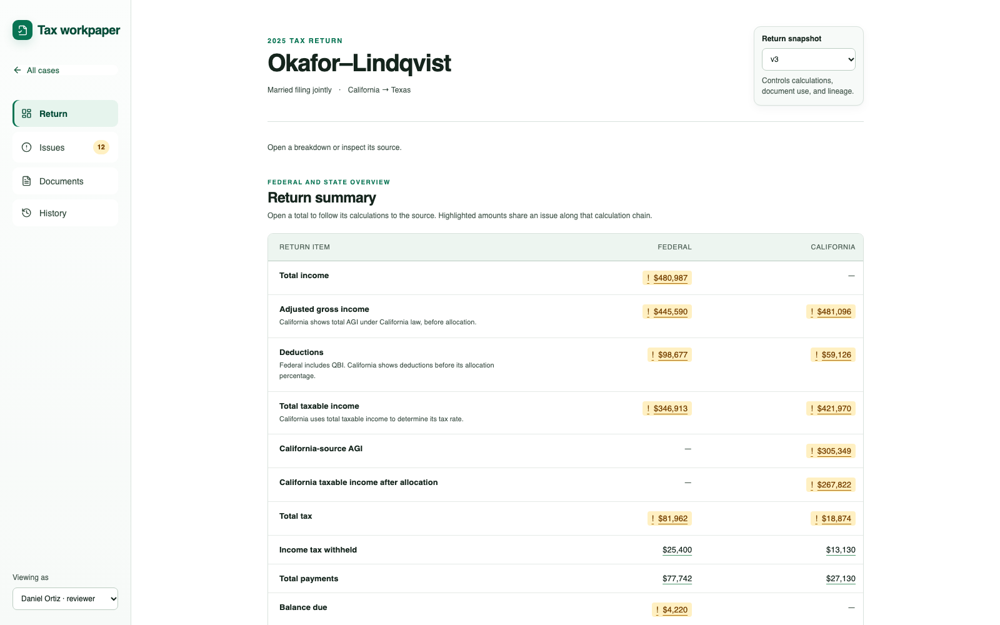

1. Open the Okafor–Lindqvist case.
2. Keep return snapshot `v3` selected.
3. Point out the federal and California summary, highlighted affected amounts, Issues count, and role selector.
4. Explain that the supplied JSON is immutable and that review work is stored separately.

Suggested narration: “The Return page is the central workpaper. A reviewer can follow any summary amount into its calculation and source evidence.”

## 2. Open the priority discrepancy

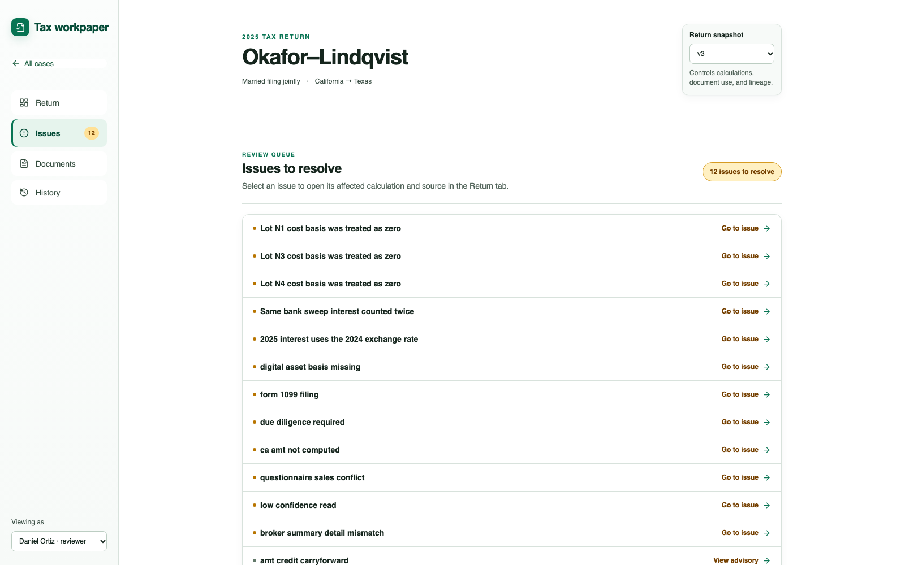

1. Open **Issues**.
2. Select **Priya Raman · preparer** under **Viewing as**.
3. Choose **Lot N1 cost basis was treated as zero**.

The queue is one entry point. It navigates to the same calculation state a reviewer can reach manually through Return.

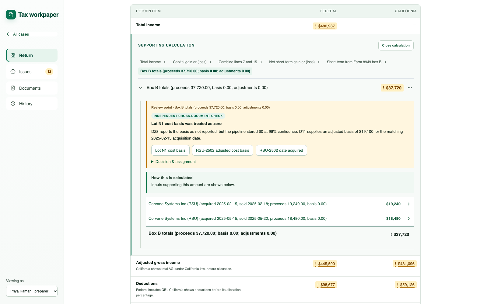

Point out the path:

`Total income → Capital gain or (loss) → Combine lines 7 and 15 → Net short-term gain or (loss) → Short-term from Form 8949 box B → Box B totals`

The full issue panel appears only at the **Box B totals** review point. Higher totals remain highlighted but do not repeat the issue interface.

## 3. Trace both source documents

Click **Lot N1 cost basis**.

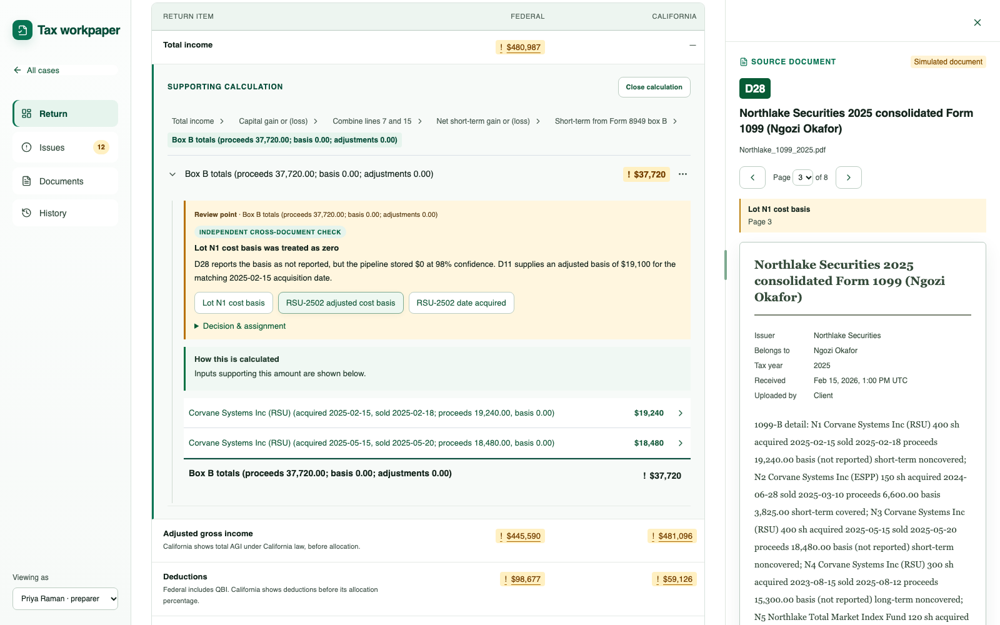

Explain that D28 reports the basis as not reported while the pipeline stored zero at high confidence. The source opens beside the calculation so the review state remains visible.

Then click **RSU-2502 adjusted cost basis**.

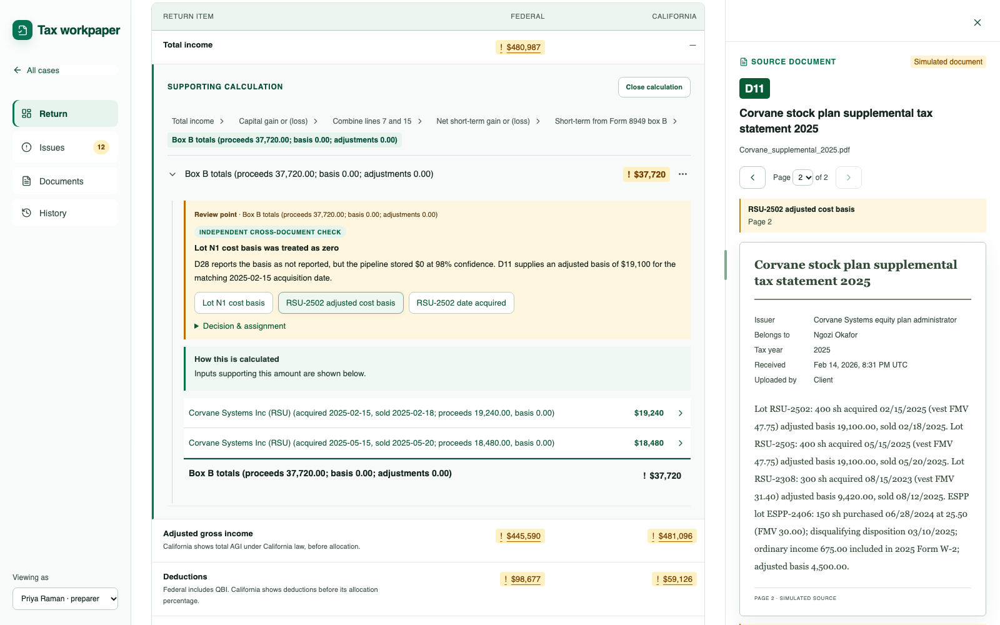

Point out D11's `$19,100` adjusted basis and the matching acquisition date. Close the evidence panel when finished.

## 4. Propose the correction

1. Expand **Decision & assignment**.
2. Click **Propose correction**.

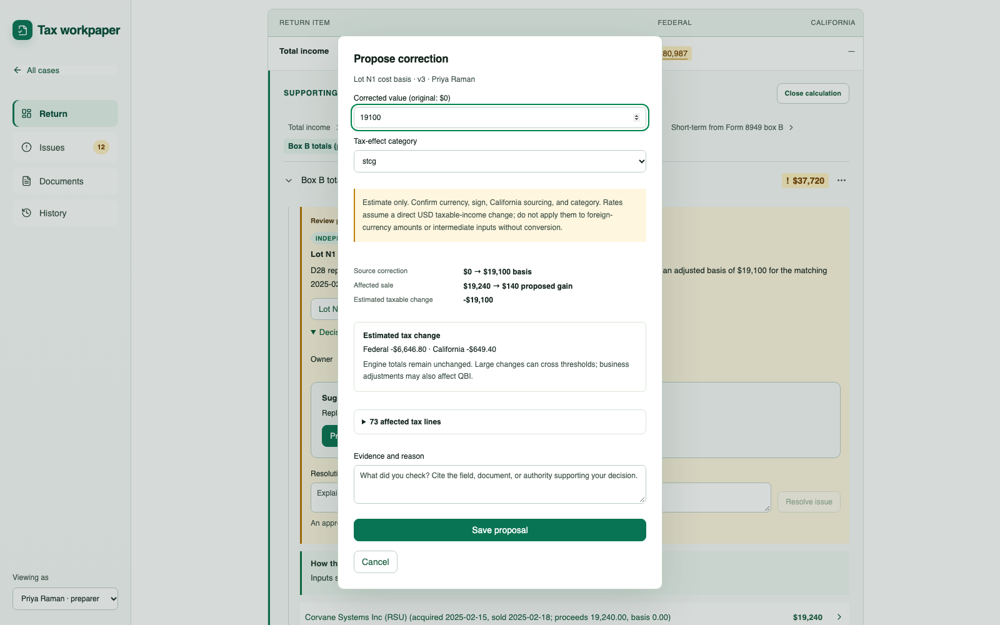

Point out:

- basis changes from `$0` to `$19,100`;
- proposed gain changes from `$19,240` to `$140`;
- taxable change is `-$19,100`;
- estimated tax effects use the supplied packet rates;
- 73 downstream lines are identified;
- engine totals remain unchanged.

Enter: `Matched D28 lot N1 to D11 using the supplied acquisition date.` Then click **Save proposal**.

## 5. Demonstrate role control

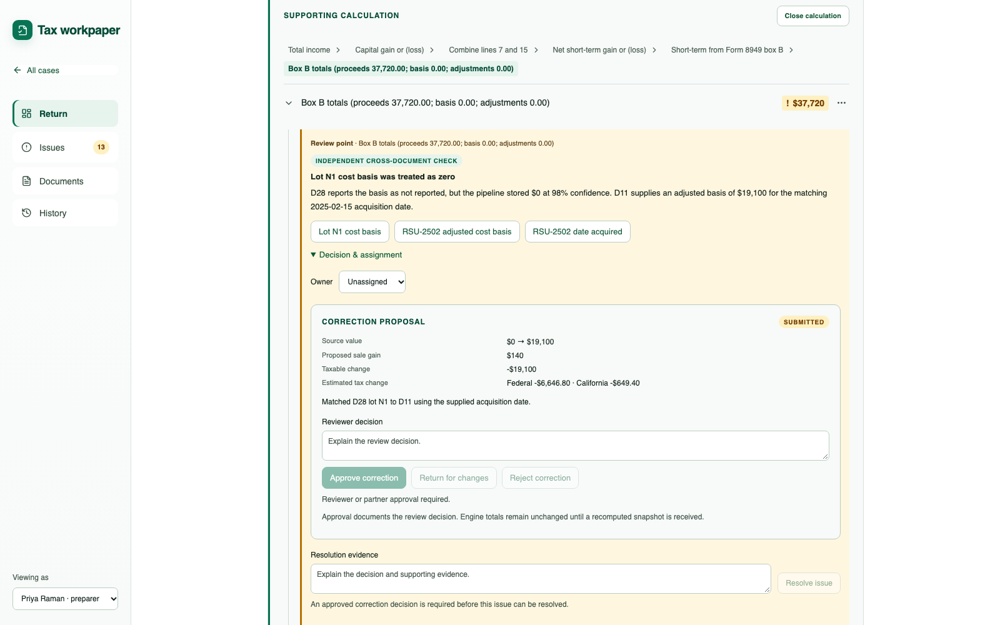

As Priya, show that approval and resolution are disabled. The submitted proposal temporarily adds a blocker because the original issue is still open and the proposal has not been reconciled.

Refresh the browser, reopen the case, select **Daniel Ortiz · reviewer**, and return to the same issue. The proposal remains saved.

Enter `Agreed the acquisition date and adjusted basis to D11.` under **Reviewer decision**, approve the correction, enter `Approved correction resolves this source discrepancy.` as resolution evidence, and resolve the issue.

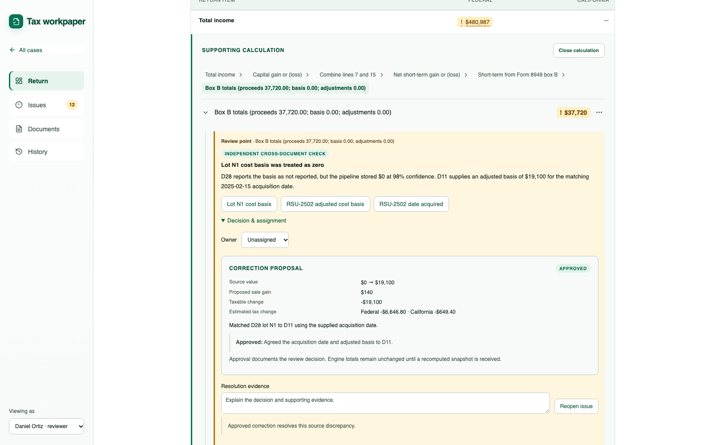

Explain that approval documents human judgment. It does not claim that a tax engine was rerun.

## 6. Prove persistence and auditability

Open **History**.

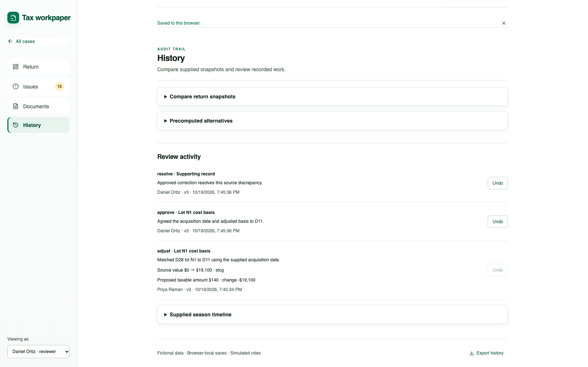

Show the three separate events:

1. Priya proposed the adjustment.
2. Daniel approved it.
3. Daniel resolved the finding.

The history preserves the actors, timestamps, return version, original and proposed values, taxable change, and rationale. **Export history** downloads the same review record as JSON.

## 7. Show filing readiness

Return to **Return** and scroll to **Final review sign-off**.

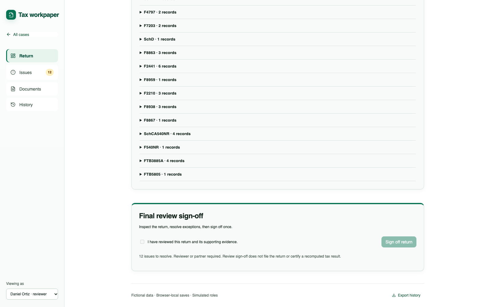

Explain that unrelated findings remain unresolved and the approved proposal has not been incorporated into a recomputed return snapshot. Final sign-off therefore remains blocked. This is the intended control behavior.

## Corrected taxable-interest path

The bank-sweep issue previously displayed two adjacent levels both labeled `Taxable interest`. They are distinct supplied records—Form 1040 line 2b and Schedule B line 4—but the unchanged carry looked like accidental duplication. The visible path now collapses only consecutive records with the same label and amount:

`Total income → Taxable interest → Total interest`

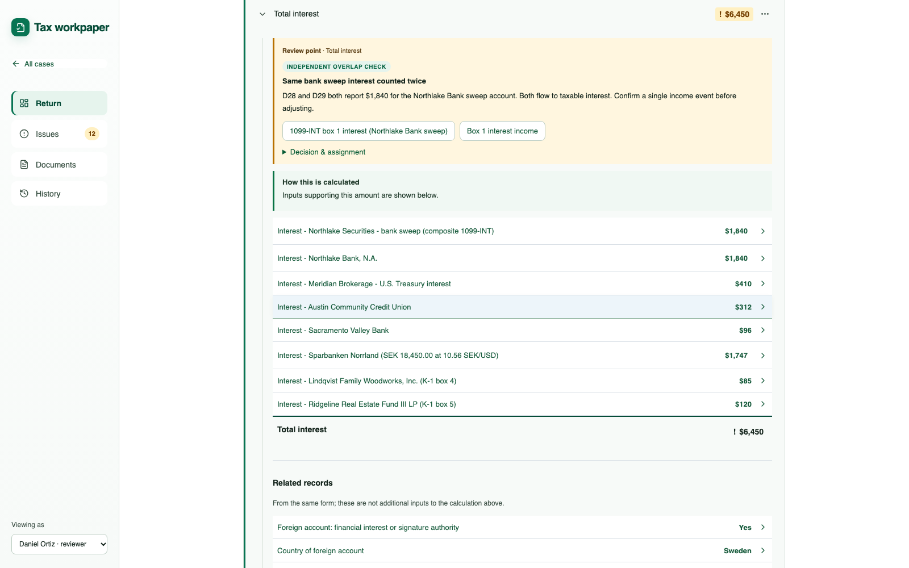

Both underlying records and their lineage remain available in the graph. This is presentation compression, not a data-model change.
